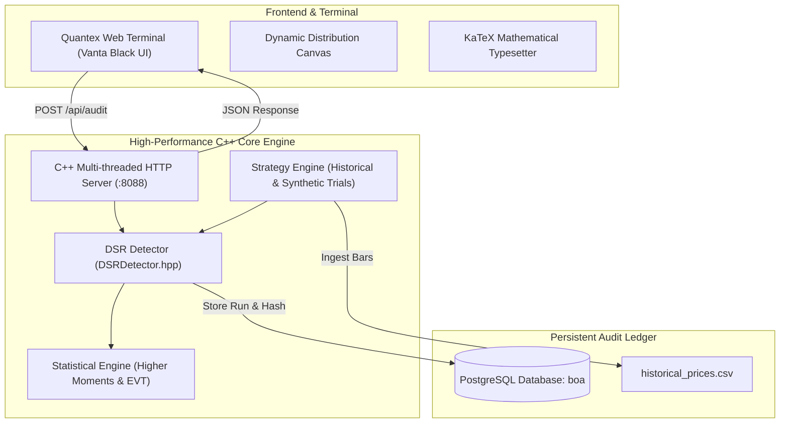

# Quantex | Institutional Backtest Overfitting Detection Engine

[](https://en.cppreference.com/w/cpp/17)
[](https://www.postgresql.org/)
[](https://opensource.org/licenses/MIT)
[]()

> **"Separating mathematical skill from lucky coin flips."**  
> An ultra-low latency, institutional quantitative auditing engine and web terminal implementing the **Deflated Sharpe Ratio (DSR)** to detect and penalize backtest selection bias, non-normal return distributions, and multiple-testing overfitting.

---

## Table of Contents
1. [The Quantitative Problem](#the-quantitative-problem)
2. [Mathematical Formulations](#mathematical-formulations)
   - [Extreme Value Theory (EVT) Hurdle Rate](#1-extreme-value-theory-evt-hurdle-rate)
   - [Bailey & López de Prado Variance Formula](#2-bailey--lópez-de-prado-variance-formula)
   - [Deflated Sharpe Ratio (DSR)](#3-deflated-sharpe-ratio-dsr)
3. [System Architecture](#system-architecture)
4. [Project Structure](#project-structure)
5. [Prerequisites & Build Instructions](#prerequisites--build-instructions)
6. [Running the Engine](#running-the-engine)
   - [Web Terminal / REST Server Mode](#1-web-terminal--rest-server-mode-default)
   - [CLI Audit Mode](#2-cli-audit-mode)
7. [API Documentation](#api-documentation)
8. [Database Schema](#database-schema)
9. [Academic References](#academic-references)

---

## The Quantitative Problem

In systematic trading and quantitative finance, multiple testing bias (*p-hacking*) is the leading cause of strategy failure upon live deployment. When an algorithm designer evaluates hundreds or thousands of parameter combinations, standard Sharpe Ratio benchmarks will inevitably select false positives purely due to noise.

Traditional statistical frameworks fail to protect capital because:
- **Sample Length (T)**: Short track records exhibit high estimation variance.
- **Selection Bias (N)**: The expected maximum Sharpe ratio increases with $\sqrt{2\ln N}$ even when true alpha is strictly zero.
- **Fat Tails & Skewness**: Financial return streams are non-IID and exhibit negative skew and leptokurtosis (fat tails), artificially inflating standard Sharpe estimates.

Quantex rigorously applies the **Deflated Sharpe Ratio (DSR)** framework formulated by David Bailey and Marcos López de Prado to compute the true statistical significance of a strategy.

---

## Mathematical Formulations

### 1. Extreme Value Theory (EVT) Hurdle Rate
Under the null hypothesis that true alpha is zero, the expected maximum Sharpe ratio ($E[\max SR]$) produced by pure selection bias across $N$ independent trials is:

$$E\Big[\max_{n=1..N} \{SR_n\}\Big] \approx \sqrt{V[SR]} \cdot \left[ (1 - \gamma)\,\Phi^{-1}\left(1 - \frac{1}{N}\right) + \gamma\,\Phi^{-1}\left(1 - \frac{1}{N e}\right) \right]$$

With asymptotic expansion:

$$E[\max SR] \approx \sqrt{V[SR]} \cdot \left[ \sqrt{2\ln N} + \frac{\gamma}{\sqrt{2\ln N}} \right]$$

- $N$: Number of backtested trial configurations.
- $V[SR]$: Variance of the Sharpe ratios across all tested trials.
- $\gamma \approx 0.5772156649$: Euler-Mascheroni constant.
- $\Phi^{-1}$: Inverse standard normal cumulative distribution function.

### 2. Bailey & López de Prado Variance Formula
Standard Sharpe ratio estimation assumes independent and identically distributed (IID) normal returns. Quantex corrects the asymptotic variance $V[SR]$ using higher statistical moments:

$$V[SR] = \frac{1 - \gamma_3\cdot SR^* + \left(\frac{\gamma_4 - 1}{4}\right)\cdot(SR^*)^2}{T - 1}$$

- $T$: Strategy track record length in trading periods (days).
- $SR^*$: Candidate strategy reported Sharpe ratio.
- $\gamma_3$: Sample skewness (penalizing left-tail risk).
- $\gamma_4$: Sample kurtosis (penalizing fat-tail outlier events; Gaussian = 3.0).

### 3. Deflated Sharpe Ratio (DSR)
The DSR is the probability that the candidate Sharpe ratio exceeds the expected maximum noise hurdle:

$$\text{DSR} = \Phi\left( \frac{SR^* - E[\max SR]}{\sqrt{V[SR]}} \right)$$

- **DSR $\ge 0.95$**: Statistically significant alpha at the 95% confidence level.
- **DSR $< 0.95$**: Strategy rejected as backtest overfitting.

---

## System Architecture



---

## Project Structure

```text
├── CMakeLists.txt              # C++17 CMake build configuration with /O2 -O3 optimization
├── schema.sql                  # PostgreSQL database relational schema & audit tables
├── data/
│   └── historical_prices.csv   # Historical asset price bars for technical trial simulation
├── include/
│   ├── DSRDetector.hpp         # Deflated Sharpe evaluation & metric orchestration
│   ├── Database.hpp            # PostgreSQL connection management & audit persistence
│   ├── HttpServer.hpp          # Lightweight multi-threaded C++ HTTP/1.1 REST server
│   ├── Statistics.hpp          # Higher moments (skew/kurtosis), Gaussian CDF, EVT expansion
│   └── Strategy.hpp            # Technical trading strategy generator & trial synthesizer
├── src/
│   ├── main.cpp                # CLI parser, server bootstrap, and seed data initialization
│   └── Statistics.cpp          # Fast implementations of inverse normal CDF and EVT math
└── web/
    ├── app.js                  # Frontend terminal logic, API bridge, and chart renderer
    ├── index.html              # Institutional landing page & interactive audit terminal
    └── style.css               # Pure Vanta Black design system (institutional styling)
```

---

## Prerequisites & Build Instructions

### Prerequisites
- **C++ Compiler**: MSVC (Visual Studio 2019+), GCC 9+, or Clang 10+ with C++17 support.
- **Build System**: CMake 3.16 or newer.
- **Database**: PostgreSQL 13+ with development libraries (`libpq`).
- **Operating System**: Windows 10/11 or Linux.

### Build via CMake

#### Windows (PowerShell / Visual Studio Developer Command Prompt)
```powershell
# Create build directory
mkdir build
cd build

# Configure and compile
cmake .. -DCMAKE_BUILD_TYPE=Release
cmake --build . --config Release

# The binary will be produced at dsr_engine.exe
```

#### Linux / macOS
```bash
mkdir -p build && cd build
cmake -DCMAKE_BUILD_TYPE=Release ..
make -j$(nproc)
```

---

## Running the Engine

### 1. Web Terminal / REST Server Mode (Default)
Run the engine in server mode on port 8088:

```bash
./dsr_engine --server --port 8088
```

Open your browser and navigate to:
```
http://localhost:8088/
```
- Access the **Institutional Landing Page** with complete mathematical derivations.
- Launch the **Quantex Interactive Terminal** to test strategies live and inspect the Monte Carlo / EVT distribution curve.

### 2. CLI Audit Mode
Execute an instant audit directly in the terminal:

```bash
./dsr_engine --cli --strategy "Alpha_Momentum_v1" --trials 1000 --days 756 --sharpe 1.85
```

**Options**:
- `--strategy <NAME>`: Identifier for the strategy (default: `Momentum_Trend_Alpha_v1`).
- `--trials <N>`: Total number of parameter combinations tested (default: `1000`).
- `--days <T>`: Track record sample length in trading days (default: `756`).
- `--sharpe <SR>`: Candidate strategy's reported Sharpe ratio (default: `1.85`).
- `--csv`: Ingest historical prices from `data/historical_prices.csv` instead of synthetic simulation.
- `--conn <CONNINFO>`: Custom PostgreSQL connection string.

---

## API Documentation

The embedded C++ server provides RESTful endpoints:

### `POST /api/audit`
Run an audit against a backtested strategy.

**Request Payload:**
```json
{
  "strategy_name": "Trend_Follower_US_Eq",
  "reported_sharpe": 1.95,
  "total_trials": 1250,
  "track_record_days": 504,
  "skewness": -0.45,
  "kurtosis": 4.80
}
```

**Response Payload:**
```json
{
  "status": "success",
  "audit_id": "aud_84920145",
  "strategy_name": "Trend_Follower_US_Eq",
  "metrics": {
    "reported_sharpe": 1.95,
    "expected_max_noise_sharpe": 1.6214,
    "trial_variance": 0.2810,
    "dsr_z_score": 1.8532,
    "dsr_p_value": 0.9681,
    "is_overfitted": false,
    "verdict": "PASS: Statistically Significant Alpha"
  },
  "execution_time_ms": 1.42
}
```

### `GET /api/history`
Fetch the historical log of audited strategies and compliance verdicts.

### `GET /api/health`
Healthcheck and system telemetry endpoint.

---

## Database Schema

Audit runs, strategy configurations, and trial outputs are logged to PostgreSQL via `schema.sql`:

- `strategies`: Strategy metadata, versioning, and developer identification.
- `audit_runs`: Audit records with reported Sharpe, expected max noise Sharpe, trial variance, DSR z-score, DSR p-value, and PASS/REJECT verdict.
- `trial_results`: Per-trial metrics, annual return, volatility, Sharpe, and parameter configurations.
- `audit_trail_hashes`: Cryptographic SHA-256 hash ledger providing immutable proof of audit timestamps for institutional compliance.

---

## Academic References

1. **Bailey, David H., and Marcos López de Prado.**  
   *"The Deflated Sharpe Ratio: Correcting for Selection Bias, Non-Normality, and Multiple Testing."*  
   *Journal of Portfolio Management*, Vol. 40, No. 5 (2014): 94–107.
2. **Bailey, David H., Jonathan Borwein, Marcos López de Prado, and Qiji Jim Zhu.**  
   *"Pseudo-Mathematics and Financial Charlatanism: The High Probability of False Discoveries in Financial Markets."*  
   *Notices of the AMS*, Vol. 61, No. 5 (2014): 458–471.
3. **Harvey, Campbell R., Yan Liu, and Heqing Zhu.**  
   *"… and the Cross-Section of Expected Returns."*  
   *The Review of Financial Studies*, Vol. 29, No. 1 (2016): 5–68.

---

## License
MIT License. Open-source for quantitative researchers, portfolio managers, and institutional developers.